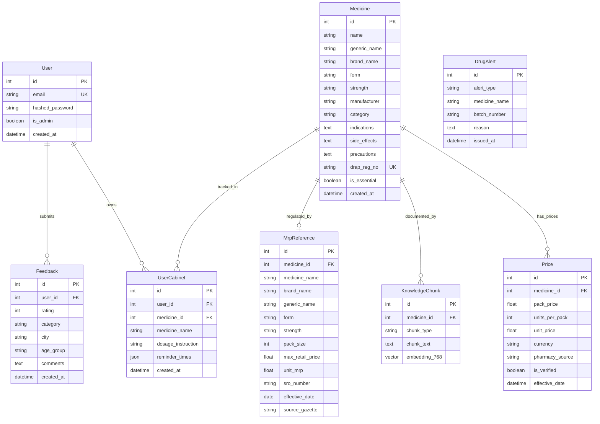
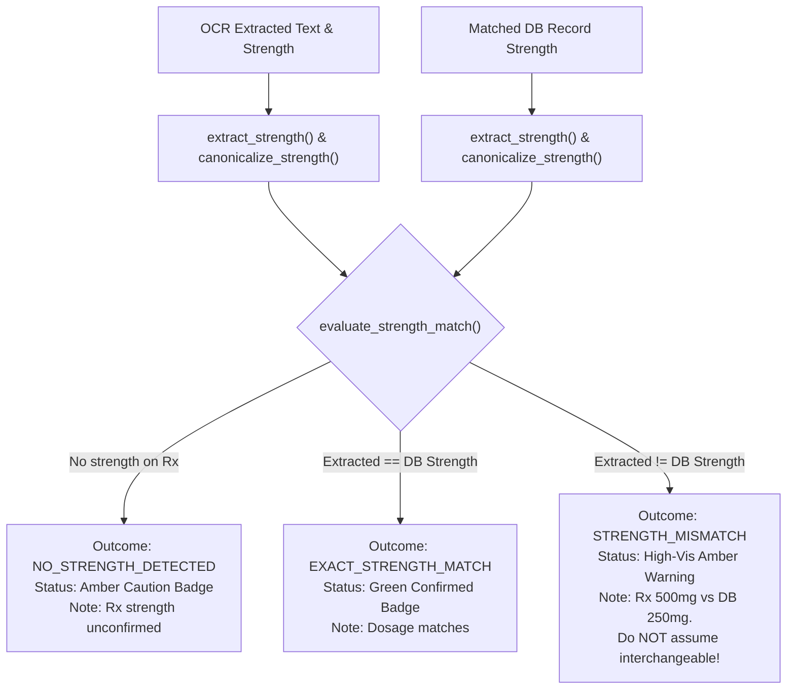
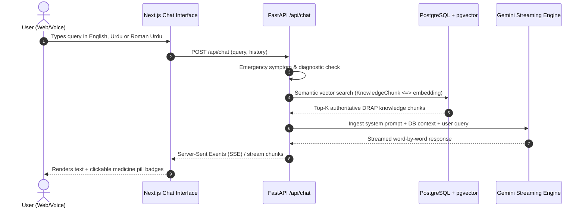

# Afiya AI — Master Architecture, Feature & Implementation Documentation

> **Document Version:** 2.0.0 (Comprehensive Technical Blueprint)  
> **Target Audience:** Autonomous Coding Agents, Principal Engineers, Healthcare Domain Developers, System Architects.  
> **Scope:** Complete architectural blueprint, subsystem breakdowns, implementation details, algorithms, database schemas, API contracts, safety protocols, and deployment infrastructure for the Afiya AI platform.

---

## Table of Contents
1. [Executive Summary & Problem Statement](#1-executive-summary--problem-statement)
2. [Complete Technology Stack](#2-complete-technology-stack)
3. [Repository & Codebase Architecture](#3-repository--codebase-architecture)
4. [Database & Storage Architecture](#4-database--storage-architecture)
5. [Core Subsystems & Feature Deep-Dives](#5-core-subsystems--feature-deep-dives)
   * 5.1 [Clinical Prescription Vision OCR & Extraction Pipeline](#51-clinical-prescription-vision-ocr--extraction-pipeline)
   * 5.2 [DRAP-Grounded Medicine Normalization & Matching Engine](#52-drap-grounded-medicine-normalization--matching-engine)
   * 5.3 [Dosage Strength Assessment & Mismatch Detection](#53-dosage-strength-assessment--mismatch-detection)
   * 5.4 [Pharmaceutical Lexicon Spell-Correction & Direction De-duplication](#54-pharmaceutical-lexicon-spell-correction--direction-de-duplication)
   * 5.5 [Official DRAP MRP Overcharge Auditor & Complaint Generator](#55-official-drap-mrp-overcharge-auditor--complaint-generator)
   * 5.6 [Bioequivalent Generic Alternative Discovery & Bachat Calculator](#56-bioequivalent-generic-alternative-discovery--bachat-calculator)
   * 5.7 [Personal Digital Medicine Cabinet & Daily Reminder Schedule](#57-personal-digital-medicine-cabinet--daily-reminder-schedule)
   * 5.8 [24/7 RAG Multilingual Conversational Clinical Assistant](#58-247-rag-multilingual-conversational-clinical-assistant)
   * 5.9 [Multi-Tier Medical Safety Guardrails & Emergency Deflection](#59-multi-tier-medical-safety-guardrails--emergency-deflection)
   * 5.10 [Dual Authentication (JWT & Clerk) and RBAC Admin Analytics](#510-dual-authentication-jwt--clerk-and-rbac-admin-analytics)
   * 5.11 [Trilingual Localization Engine (English, Urdu, Roman Urdu)](#511-trilingual-localization-engine-english-urdu-roman-urdu)
6. [API Specification & Data Contracts](#6-api-specification--data-contracts)
7. [Safety, Legal & Compliance Architecture](#7-safety-legal--compliance-architecture)
8. [Local Development, Testing & Verification Playbook](#8-local-development-testing--verification-playbook)
9. [Production Deployment & Zero-Downtime Infrastructure](#9-production-deployment--zero-downtime-infrastructure)

---

## 1. Executive Summary & Problem Statement

### 1.1 The Context: Healthcare Reality in Pakistan
In developing healthcare systems such as Pakistan's, over 130 million citizens navigate retail pharmacy transactions without institutional health insurance or electronic health records (EHR). This reality exposes patients and families to systemic risks:
1. **Prescription Legibility & Medication Errors:** Doctors frequently handwrite prescriptions using obscure Latin abbreviations (*OD, BD, TDS, ac, pc*) and brand trade names. Optical misinterpretation by overburdened pharmacy staff contributes to fatal drug dispensing errors globally.
2. **Price Gouging & Unregulated Inflation:** Although the **Drug Regulatory Authority of Pakistan (DRAP)** establishes statutory Maximum Retail Prices (MRP) via official Federal Government Gazettes and Statutory Regulatory Orders (S.R.O.s), retail pharmacies routinely overcharge consumers between 20% and 150% above the legally sanctioned price ceiling.
3. **Originator Brand Monopoly & Consumer Blindness:** Multinational originator brands (e.g., Augmentin, Panadol, Risek) dominate prescriptions. Patients spend disproportionate household income on brand names unaware that chemically identical, bioequivalent local generic medicines certified by DRAP are available at 40%–70% lower cost.
4. **Language & Health Literacy Divide:** Prescriptions are written in Latin-English shorthand, creating an impenetrable barrier for Urdu-speaking or Roman Urdu-literate households.
5. **Polypharmacy & Schedule Non-Adherence:** Patients with chronic diseases (hypertension, diabetes, cardiac conditions) often take 4 to 8 medications daily, frequently missing doses or taking incompatible pills simultaneously.

### 1.2 The Solution: Afiya AI
Afiya AI is an end-to-end pharmaceutical intelligence and prescription verification platform built specifically to eliminate these informational asymmetries:
* **Decodes Handprinted Prescriptions:** Uses local computer vision preprocessing combined with multimodal Gemini vision models and a localized pharmaceutical lexicon corrector to identify brands, molecules, strengths, forms, and dosage frequencies.
* **Audits Pharmacy Invoices Against Law:** Benchmarks prices against the official DRAP Gazette, calculates overcharges in PKR, and produces exportable formal consumer complaint documentation.
* **Democratizes Bioequivalent Savings:** Unearths identical generic alternatives and computes monthly and annual household savings (*Bachat*).
* **Guarantees Patient Safety:** Strictly enforces **"NO DIAGNOSIS, NO PRESCRIBING"**. Deflects critical symptoms to Pakistan Emergency Services (1122), flags Look-Alike Sound-Alike (LASA) risks, and bounds every answer strictly within verified DRAP database records.
* **Translates Directions Trilingually:** Converts doctor notes into English, native Urdu (`اردو`), and Roman Urdu (`"1 goli subah aur raat khane ke baad"`).

---

## 2. Complete Technology Stack

### 2.1 Backend Architecture
* **Language & Runtime:** Python 3.12+ (64-bit).
* **Framework:** **FastAPI** (v0.115+) with Starlette ASGI asynchronous event loop.
* **Data Validation & Schemas:** **Pydantic v2** (`pydantic-settings`).
* **Database ORM:** **SQLAlchemy 2.0 Async** with greenlet asyncio concurrency.
* **Database Drivers:**
  * Production: `asyncpg` (PostgreSQL driver for Neon Serverless).
  * Testing/Local: `aiosqlite` (Zero-configuration local SQLite storage).
* **Vector Similarity Engine:** `pgvector` (cosine vector distance `<=>` for RAG semantic search).
* **Vision & Multimodal LLM Client:** `google-generativeai` / `google.genai` SDK.
* **Computer Vision & Image Processing:** `Pillow` (PIL) for EXIF rotation, contrast normalization, and dimension bounding.
* **String & Fuzzy Matching:** `RapidFuzz` (high-performance C++ based Levenshtein distance and token sort matching).
* **Security & Auth:** `python-jose` (JWT decoding/signing), `passlib[bcrypt]`, `httpx` (async JWKS verification for Clerk).
* **Testing Suite:** `pytest` + `pytest-asyncio` + `httpx`.

### 2.2 Frontend Architecture
* **Framework:** **Next.js 16.2+** (App Router architecture with React Server Components and Turbopack compiler).
* **Language:** TypeScript 5.x (Strict type safety, zero `any` policy in core domain).
* **Styling & Design System:** Tailwind CSS v3 with custom medical cyan/teal palette (`#0d9488`, `#0f172a`), backdrop blur glassmorphism, and responsive CSS grid.
* **Authentication:** **Clerk Next.js SDK** (`@clerk/nextjs`) integrated with backend JWT headers.
* **Speech & Audio:** Web Speech API (`webkitSpeechRecognition` / native `SpeechRecognition`) with client-side noise suppression and synthesized Text-to-Speech (TTS).
* **Icons:** `lucide-react`.
* **State Management:** React 19 Hooks (`useState`, `useEffect`, `useCallback`, `useMemo`, `useRef`).

### 2.3 Cloud Infrastructure & Deployment
* **Frontend Hosting:** Vercel Edge / Serverless Platform.
* **Backend Hosting:** Railway / Render containerized Docker environment.
* **Database Hosting:** Neon Serverless PostgreSQL with autoscale-to-zero compute and copy-on-write branching.
* **Static Assets:** Bundled Next.js public directory and Railway container root.

```
                                  [ User Client ]
                     (Browser / Mobile / Tablet / Speech Audio)
                                         │
                                         ▼
                     ┌────────────────────────────────────────┐
                     │         Next.js 16 App Router          │
                     │  (TypeScript, TailwindCSS, Clerk Auth) │
                     └───────────────────┬────────────────────┘
                                         │ HTTPS / REST JSON
                                         ▼
                     ┌────────────────────────────────────────┐
                     │          FastAPI Backend Engine        │
                     │  (Async ASGI, Pydantic v2, SQLAlchemy) │
                     └───────┬──────────────────────┬─────────┘
                             │                      │
         ┌───────────────────┴───────┐      ┌───────┴───────────────────┐
         ▼                           ▼      ▼                           ▼
┌──────────────────┐    ┌─────────────────┐ ┌────────────────┐ ┌────────────────┐
│   Gemini Vision  │    │  Pillow Image   │ │ PostgreSQL +   │ │ Safety Layer & │
│  Multimodal OCR  │    │  Preprocessor   │ │    pgvector    │ │ 1122 Deflector │
│ (Model Fallback) │    │ & Normalization │ │  (Neon Server) │ │ Guardrail Gate │
└──────────────────┘    └─────────────────┘ └────────────────┘ └────────────────┘
```

---

## 3. Repository & Codebase Architecture

```
AfiyaAI/
├── .qoder/                          # Agent guidelines, rules, and execution skills
│   ├── rules/                       # Behavioral constraints and safety mandates
│   └── skills/                      # Procedural agent workflows
├── apps/
│   ├── api/                         # FastAPI Backend Application
│   │   ├── app/
│   │   │   ├── db/
│   │   │   │   └── database.py      # SQLAlchemy models, engine, session & init_db
│   │   │   ├── models/
│   │   │   │   └── schemas.py       # Pydantic input/output schemas
│   │   │   ├── routers/             # API HTTP endpoints
│   │   │   │   ├── admin.py         # Admin survey metrics & data export
│   │   │   │   ├── auth.py          # Register, login, Clerk token exchange
│   │   │   │   ├── cabinet.py       # User digital medicine cabinet CRUD
│   │   │   │   ├── chat.py          # Grounded streaming RAG assistant
│   │   │   │   ├── feedback.py      # Healthcare feedback & survey submission
│   │   │   │   ├── health.py        # Health probe & uptime monitor
│   │   │   │   ├── medicines.py     # Search, match, details, alternatives
│   │   │   │   ├── ocr.py           # Prescription upload & vision extraction
│   │   │   │   └── price_check.py   # DRAP MRP overcharge checker
│   │   │   ├── services/            # Pure domain services
│   │   │   │   ├── auth_dependency.py      # Clerk & JWT user resolution
│   │   │   │   ├── auth_service.py         # Passlib password hashing & tokens
│   │   │   │   ├── chat_service.py         # Semantic search & streaming prompt
│   │   │   │   ├── image_preprocessor.py   # Contrast, orientation, dimension
│   │   │   │   ├── matching_service.py     # 4-tier brand/generic matcher
│   │   │   │   ├── ocr_service.py          # Multimodal OCR + Circuit Breaker
│   │   │   │   ├── pharmaceutical_corrector.py # Rx typo corrector & shorthand
│   │   │   │   ├── safety_layer.py         # DRAP verification & risk tiers
│   │   │   │   ├── seed_data.py            # DRAP registry dataset seeder
│   │   │   │   ├── seed_embeddings.py      # Knowledge chunk vectorization
│   │   │   │   ├── seed_manual.py          # MRP price benchmark seeder
│   │   │   │   └── voice_guardrail.py      # Voice audio intent sanitizer
│   │   │   ├── config.py            # Pydantic BaseSettings & env configs
│   │   │   └── main.py              # Application factory, CORS, lifespan
│   │   ├── tests/                   # 154 Passing Pytest Test Suites
│   │   │   ├── test_admin.py
│   │   │   ├── test_auth.py
│   │   │   ├── test_auth_gating.py
│   │   │   ├── test_cabinet.py
│   │   │   ├── test_chat.py
│   │   │   ├── test_cheapest_brand.py
│   │   │   ├── test_feedback.py
│   │   │   ├── test_fuzzy_matching.py
│   │   │   ├── test_ocr_pipeline.py
│   │   │   ├── test_price_check.py
│   │   │   ├── test_safety.py
│   │   │   ├── test_safety_and_voice.py
│   │   │   ├── test_seed_embeddings.py
│   │   │   └── test_seed_knowledge.py
│   │   ├── requirements.txt         # Pinned backend dependencies
│   │   └── Dockerfile               # Container build instructions
│   │
│   └── web/                         # Next.js 16 TypeScript Frontend
│       ├── src/
│       │   ├── app/
│       │   │   ├── admin/
│       │   │   │   └── page.tsx     # Admin survey analytics dashboard
│       │   │   ├── layout.tsx       # Global layout, Clerk, Header, Footer
│       │   │   ├── page.tsx         # Main user application cockpit
│       │   │   └── globals.css      # Custom Tailwind styling & glassmorphism
│       │   ├── components/
│       │   │   ├── chat/            # ChatInterface, VoiceAssistantModal
│       │   │   ├── feedback/        # FeedbackModal, FeedbackCard
│       │   │   ├── guide/           # OnboardingGuideModal
│       │   │   ├── layout/          # Header, Footer
│       │   │   ├── medicine/        # MedicineCard, MedicineDetailModal,
│       │   │   │                    # CabinetModal, SaveToCabinetButton,
│       │   │   │                    # CheapestBrandBanner, LASAConfirmationGate
│       │   │   ├── mrp/             # MrpChecker (Overcharge auditor)
│       │   │   ├── search/          # SearchBar, SearchHero, CategoryPills
│       │   │   ├── shared/          # VoiceButton, CustomCursor
│       │   │   └── upload/          # PrescriptionUpload, OCRResults
│       │   └── lib/
│       │       ├── api.ts           # Type-safe backend HTTP client
│       │       ├── constants.ts     # Category maps, colors, DRAP baselines
│       │       ├── i18n.ts          # Trilingual translation dictionaries
│       │       ├── types.ts         # TypeScript interface definitions
│       │       ├── useSpeechRecognition.ts # Web Speech API voice hook
│       │       └── voiceGuardrail.ts# Client-side acoustic intent filter
│       ├── package.json             # NPM dependencies & scripts
│       ├── tsconfig.json            # TypeScript compiler configuration
│       └── tailwind.config.ts       # Tailwind CSS theme extensions
├── data/                            # Raw pharmaceutical datasets & seed CSVs
│   ├── drap_verified_40.json        # Curated 40 DRAP baseline medicines
│   └── mrp_gazette_2024.csv         # DRAP 2024 S.R.O. Price Gazettes
├── docs/                            # Architecture Decision Records (ADRs)
└── specs/                           # 12 Detailed Domain Specifications
```

---

## 4. Database & Storage Architecture

### 4.1 Hybrid Storage Strategy
To achieve high velocity during test suites while guaranteeing zero-downtime reliability in production:
* **Production Environment:** **Neon Serverless PostgreSQL (v16+)** with the `pgvector` extension enabled for high-dimensional vector embeddings (768 dimensions from Google text-embedding models).
* **Local & Test Environment:** **SQLite 3** accessed via `aiosqlite` (`afiya_test.db`). Vector distance queries fall back defensively to mockable similarity computations so that all 154 unit tests execute in isolated local memory without cloud dependencies.

### 4.2 Entity Relational Model



### 4.3 Database Schema Migration Resilience
In [`apps/api/app/db/database.py`](file:///D:/Works/Hackathon%202/AfiyaAI/apps/api/app/db/database.py), the `init_db()` lifecycle function guarantees safe schema evolution across both SQLite and PostgreSQL. When new columns (`dosage_instruction` and `reminder_times`) were introduced to `UserCabinet`, additive `ALTER TABLE` statements execute inside defensive exception handlers:
```python
if is_sqlite:
    try: await conn.execute(text("ALTER TABLE user_cabinet ADD COLUMN dosage_instruction VARCHAR(255)"))
    except Exception: pass
    try: await conn.execute(text("ALTER TABLE user_cabinet ADD COLUMN reminder_times JSON"))
    except Exception: pass
else:
    try: await conn.execute(text("ALTER TABLE user_cabinet ADD COLUMN IF NOT EXISTS dosage_instruction VARCHAR(255)"))
    except Exception: pass
    try: await conn.execute(text("ALTER TABLE user_cabinet ADD COLUMN IF NOT EXISTS reminder_times JSON"))
    except Exception: pass
```

---

## 5. Core Subsystems & Feature Deep-Dives

---

### 5.1 Clinical Prescription Vision OCR & Extraction Pipeline

#### A. Problem & Architecture
Doctor prescriptions in Pakistan feature messy handwriting, variable camera lighting, and informal shorthand. Furthermore, Gemini Free-Tier API endpoints enforce request rate limits (5 RPM / 20 RPD on select preview models), which previously caused hanging requests when secondary models stalled.

#### B. Implementation Breakdown
Located in [`apps/api/app/services/ocr_service.py`](file:///D:/Works/Hackathon%202/AfiyaAI/apps/api/app/services/ocr_service.py) and [`image_preprocessor.py`](file:///D:/Works/Hackathon%202/AfiyaAI/apps/api/app/services/image_preprocessor.py):

1. **Deterministic Caching:**  
   Every uploaded image byte stream is hashed using SHA-256 (`hashlib.sha256(image_bytes).hexdigest()`). If an identical image is uploaded again, the parsed extraction is returned in **0 milliseconds** without calling external APIs.
2. **Local Computer Vision Preprocessing (`image_preprocessor.py`):**
   * **EXIF Transposition:** Corrects orientation metadata from smartphone cameras.
   * **Resolution Bounding:** Constrains the longest image dimension to `1600px` (scaled with high-quality Lanczos resampling). This reduces upload payloads from ~3MB down to ~300KB without sacrificing handwriting legibility.
   * **Grayscale & Autocontrast:** Adjusts histogram cutoffs (`cutoff=0.5`) and enhances contrast (`1.08x`) and sharpness (`1.10x`) to isolate dark ink strokes from background paper artifacts.
   * **JPEG Quality Tuning:** Encodes to JPEG at `quality=88` (disabling CPU-intensive multi-pass entropy encoding), reducing Pillow execution time from ~300ms to ~40ms.
3. **High-Speed Model Fallback Hierarchy:**  
   To prevent server stalls, the service uses an active model priority chain:
   * **Priority 1:** `models/gemini-3.5-flash` (Primary vision model).
   * **Priority 2:** `models/gemini-3-flash-preview` (Ultra-fast response: 1.5s–2.5s).
   * **Priority 3:** `models/gemini-3.6-flash` (Fast fallback: 2.0s–3.0s).
   * **Priority 4:** `models/gemini-3.7-flash`.
   * **Priority 5:** `models/gemini-flash-latest`.
   *(Hanging "lite" models that caused 180s timeouts were completely eliminated).*
4. **Dynamic In-Memory Circuit Breaker (`_MODEL_COOLDOWNS`):**  
   When any model returns HTTP 429 (`ResourceExhausted`), the system parses the `retry_delay` seconds returned in the Google API payload (defaulting to 60s) and records a cooldown timestamp:
   ```python
   _MODEL_COOLDOWNS[model_name] = time.time() + cooldown_seconds
   ```
   On subsequent scans, any model still in cooldown is skipped in **0.000s**, preventing dead network roundtrips.
5. **Non-Blocking Asynchronous Generation:**  
   Uses `await model.generate_content_async(..., request_options={"timeout": 12.0})` to prevent thread blocking while enforcing a strict 12-second ceiling.

---

### 5.2 DRAP-Grounded Medicine Normalization & Matching Engine

#### A. Problem & Architecture
Prescriptions may write `"Tab Augmentin 625 mg"`, `"Cap Risek 20"`, or `"Panadol extra"`. The matching service must bridge messy OCR tokens to verified DRAP database entries.

#### B. Implementation Breakdown
Located in [`apps/api/app/services/matching_service.py`](file:///D:/Works/Hackathon%202/AfiyaAI/apps/api/app/services/matching_service.py):

The matching pipeline executes four deterministic, cascading tiers:
1. **Tier 1 — Exact Normalized Match:**  
   Converts the query to lowercase, strips punctuation, and queries against `Medicine.name` or `Medicine.brand_name`.
2. **Tier 2 — Brand Match Without Strength:**  
   Extracts and removes trailing strength indicators (e.g. `"Panadol 500mg"` -> `"Panadol"`). Matches against registered brands.
3. **Tier 3 — Generic Active Ingredient Match:**  
   If the physician wrote the active chemical molecule (e.g., `"Paracetamol"`, `"Omeprazole"`, `"Clarithromycin"`), matches against `Medicine.generic_name` and returns all registered brand presentations sorted by price.
4. **Tier 4 — Whole-Word Token Set & Fuzzy Match:**  
   Uses `RapidFuzz` token set ratio with a strict threshold (`score >= 82.0`). This handles common optical misreads (e.g., `"Panado1"` -> `"Panadol"`, `"Augmntin"` -> `"Augmentin"`).

---

### 5.3 Dosage Strength Assessment & Mismatch Detection

#### A. Problem Solved (Critical Patient Safety Bug)
*Previous Behavior:* An OCR scan of `"Klaricid 500mg"` was matching to a database record of `"Klaricid (Clarithromycin - 250mg)"` and displaying a green "Matched" badge without warning the user of the 2x dosage discrepancy.

#### B. The 3-Tier Strength Assessment Algorithm
Implemented across:
* Backend: [`apps/api/app/services/matching_service.py`](file:///D:/Works/Hackathon%202/AfiyaAI/apps/api/app/services/matching_service.py)
* Frontend: [`apps/web/src/components/upload/OCRResults.tsx`](file:///D:/Works/Hackathon%202/AfiyaAI/apps/web/src/components/upload/OCRResults.tsx) and [`apps/web/src/app/page.tsx`](file:///D:/Works/Hackathon%202/AfiyaAI/apps/web/src/app/page.tsx)



1. **`extract_strength(text: str) -> Optional[str]`:**  
   Uses regular expressions matching numbers followed by pharmaceutical units: `mg`, `g`, `mcg`, `ml`, `iu`, `%`, `mg/5ml`.
2. **`canonicalize_strength(val: str) -> Optional[str]`:**  
   Normalizes spacing and unit abbreviations (`"500 mg"` -> `"500mg"`, `"0.5 g"` -> `"500mg"`).
3. **Outcomes & UI Representation:**
   * `EXACT_STRENGTH_MATCH`: Renders standard green verified styling.
   * `STRENGTH_MISMATCH`: **Strips all confident green styling.** Replaces it with a high-visibility amber warning box displaying both values explicitly:
     > *"⚠️ Strength Mismatch: Prescription shows 500mg — closest database match is 250mg. Do not assume these are interchangeable without pharmacist confirmation."*
   * `NO_STRENGTH_DETECTED`: Displays database strength accompanied by an unconfirmed caveat badge.

---

### 5.4 Pharmaceutical Lexicon Spell-Correction & Direction De-duplication

#### A. Problem Solved
OCR and shorthand translation frequently produced cluttered, repetitive directions such as:
`"1 tablet 2 times daily (morning & night) 2 times daily (BD) (2 times daily (BD))"`.

#### B. Implementation Breakdown
Located in [`apps/api/app/services/pharmaceutical_corrector.py`](file:///D:/Works/Hackathon%202/AfiyaAI/apps/api/app/services/pharmaceutical_corrector.py) and [`apps/web/src/lib/i18n.ts`](file:///D:/Works/Hackathon%202/AfiyaAI/apps/web/src/lib/i18n.ts):

1. **Concept-Based Frequency Equivalence Sets (`FREQ_EQUIVALENTS`):**
   ```python
   FREQ_EQUIVALENTS = {
       "od": {"once daily", "1 time daily", "1 tablet once daily"},
       "bd": {"twice daily", "2 times daily", "1 tablet twice daily", "morning & night"},
       "tds": {"3 times daily", "three times daily", "1 tablet 3 times daily"},
       "qds": {"4 times daily", "four times daily"},
   }
   ```
   Before appending any shorthand expansion to directions, the service checks whether an equivalent concept already exists in the text.
2. **Pre-Clean Parenthetical Stripper (`i18n.ts`):**  
   A regex passes through the instruction string and removes redundant nested abbreviations (e.g. `(2 times daily (BD))` -> `2 times daily (BD)`).
3. **Trilingual Localization:**  
   Translates deduplicated English directions into natural Urdu and Roman Urdu:
   * Urdu: `1 گولی صبح اور رات (کھانے کے بعد)`
   * Roman Urdu: `1 goli subah aur raat (khane ke baad)`

---

### 5.5 Official DRAP MRP Overcharge Auditor & Complaint Generator

#### A. Problem & Regulation
Under the Drug Act 1976 and DRAP Maximum Retail Price notifications, retail pharmacies cannot charge more than the printed MRP ceiling.

#### B. Implementation Breakdown
Located in [`apps/api/app/services/price_check.py`](file:///D:/Works/Hackathon%202/AfiyaAI/apps/api/app/routers/price_check.py) and [`apps/web/src/components/mrp/MrpChecker.tsx`](file:///D:/Works/Hackathon%202/AfiyaAI/apps/web/src/components/mrp/MrpChecker.tsx):

1. **Price Verification Logic:**  
   Calculates unit price paid vs. statutory unit price:
   $$\text{unit\_price} = \frac{\text{price\_paid}}{\text{pack\_size}}$$
   $$\text{overcharge\_amount} = \max(0.0, \text{price\_paid} - \text{max\_retail\_price})$$
2. **Compliance Tiers:**
   * 🟢 `OK_AT_MRP`: Price paid $\le$ statutory MRP.
   * 🔴 `OVERCHARGED`: Price paid $>$ statutory MRP.
   * 🔵 `BELOW_MRP`: Pharmacy applied a consumer discount.
3. **Formal Complaint Slip Generator:**  
   Generates a structured, exportable complaint slip citing the official S.R.O. number, date, pharmacy details, overcharge percentage, and instructions for filing complaints with the DRAP Federal Drug Inspectorate.

---

### 5.6 Bioequivalent Generic Alternative Discovery & Bachat Calculator

#### A. Problem & Mechanism
When an expensive originator medicine (e.g., Augmentin 625mg @ Rs. 380/pack) is prescribed, patients need to see certified bioequivalent alternatives.

#### B. Implementation Breakdown
Located in [`apps/api/app/routers/medicines.py`](file:///D:/Works/Hackathon%202/AfiyaAI/apps/api/app/routers/medicines.py) and [`apps/web/src/components/medicine/CheapestBrandBanner.tsx`](file:///D:/Works/Hackathon%202/AfiyaAI/apps/web/src/components/medicine/CheapestBrandBanner.tsx):

1. **Bioequivalent Discovery Query:**  
   Filters the database by identical `generic_name`, `form`, and `strength`, excluding the currently viewed medicine:
   ```sql
   SELECT * FROM medicines 
   WHERE generic_name = :gen 
     AND form = :form 
     AND strength = :str 
     AND id != :curr_id;
   ```
2. **Bachat Calculation:**
   $$\text{Absolute Savings} = \text{Current Brand Price} - \text{Cheapest Alternative Price}$$
   $$\text{Percentage Savings} = \left(\frac{\text{Absolute Savings}}{\text{Current Brand Price}}\right) \times 100$$
3. **Interactive Brand Switcher:** Clicking any alternative instantly updates the active profile, price comparisons, and DRAP registration metadata.

---

### 5.7 Personal Digital Medicine Cabinet & Daily Reminder Schedule

#### A. Features & Architecture
Located in [`apps/api/app/routers/cabinet.py`](file:///D:/Works/Hackathon%202/AfiyaAI/apps/api/app/routers/cabinet.py) and [`apps/web/src/components/medicine/CabinetModal.tsx`](file:///D:/Works/Hackathon%202/AfiyaAI/apps/web/src/components/medicine/CabinetModal.tsx):

1. **Multi-Item & Batch Saving:**
   * Individual *"Save to Cabinet"* button on each medicine card.
   * Batch *"⭐ Save All to Cabinet"* button on OCR results that adds all extracted prescription medicines in a single action.
2. **Persistent Dosage Directions & Routine Schedule:**
   * Stores `dosage_instruction` (e.g., `"1 tablet twice daily after meals"`).
   * Stores `reminder_times` JSON object with boolean toggles:
     * `morning`: 8:00 AM (صبح)
     * `afternoon`: 2:00 PM (دوپہر)
     * `night`: 8:00 PM (رات)
3. **Afiya Household Bachat Estimator:**  
   Aggregates all cabinet medicines to calculate total monthly prescription expenditure, projects potential generic savings (45%–55%), and displays annual household savings in PKR.
4. **1-Click WhatsApp Schedule Share:**  
   Constructs a formatted bilingual WhatsApp text message summarizing medicines, dosages, times, and prices with a direct `https://api.whatsapp.com/send?text=...` trigger.

---

### 5.8 24/7 RAG Multilingual Conversational Clinical Assistant

#### A. Architecture & RAG Pipeline
Located in [`apps/api/app/services/chat_service.py`](file:///D:/Works/Hackathon%202/AfiyaAI/apps/api/app/services/chat_service.py) and [`apps/web/src/components/chat/ChatInterface.tsx`](file:///D:/Works/Hackathon%202/AfiyaAI/apps/web/src/components/chat/ChatInterface.tsx):



1. **Semantic Knowledge Retrieval:**
   * Knowledge chunks cover Indications, Dosages, Side Effects, Food Interactions, and Precautions.
   * Uses 768-dimensional embeddings to perform cosine similarity distance ranking in `pgvector`.
2. **Fact Grounding Enforcement:**  
   The system prompt strictly commands the LLM to synthesize responses **only** from retrieved chunks. It is forbidden from inventing medical facts, clinical trials, or unofficial prices.
3. **Interactive UI Pill Badges:**  
   When the assistant mentions a registered medicine (e.g., `"Augmentin"` or `"Panadol"`), the UI renders an interactive clickable badge that opens the medicine's full profile modal.
4. **Audio Text-to-Speech (TTS):**  
   Users can listen to explanations read aloud in clear, synthesized voice.

---

### 5.9 Multi-Tier Medical Safety Guardrails & Emergency Deflection

#### A. The Golden Rule
> **NO DIAGNOSIS. NO PRESCRIBING.**  
> Afiya AI is an information and price verification assistant, never a substitute for a licensed physician.

#### B. Implementation Details
Located in [`apps/api/app/services/safety_layer.py`](file:///D:/Works/Hackathon%202/AfiyaAI/apps/api/app/services/safety_layer.py) and [`voice_guardrail.py`](file:///D:/Works/Hackathon%202/AfiyaAI/apps/api/app/services/voice_guardrail.py):

1. **Emergency Symptom Deflector:**  
   Scans input queries against clinical emergency trigger sets (in English, Urdu, and Roman Urdu):
   * *Triggers:* Chest pain, severe bleeding, difficulty breathing, poisoning, overdose, unconsciousness, suicide/self-harm.
   * *Action:* Blocks AI generation immediately. Returns an emergency alert directing the user to **call 1122 (Pakistan Emergency Services)** or report to the nearest hospital emergency room.
2. **Clinical Disease Diagnosis Blocker:**  
   Queries asking *"What disease do I have?"* or *"Diagnose my condition"* are intercepted with an explanation that diagnosing medical conditions requires physical clinical examination and diagnostic tests by a licensed doctor.
3. **DRAP Regulatory Risk Classification (3 Tiers):**
   * **Tier 1 (OTC):** Over-the-counter medications (e.g., Paracetamol, ORS). Safe for self-administration per package instructions.
   * **Tier 2 (Prescription-Only):** Antibiotics, antihypertensives, NSAIDs. Must be verified against a valid doctor's prescription.
   * **Tier 3 (High-Risk / Controlled):** Narcotics, sedatives, psychiatric medications, chemotherapy. Strict warnings: requires hospital/specialist dispensing.
4. **Look-Alike Sound-Alike (LASA) Warning Gate:**  
   Identifies drugs with confusingly similar names (e.g., *Celebrex* vs. *Celexa*, *Losec* vs. *Lasix*). Requires explicit user confirmation before viewing or saving to avoid accidental confusion.

---

### 5.10 Dual Authentication (JWT & Clerk) and RBAC Admin Analytics

#### A. Architecture Breakdown
Located in [`apps/api/app/services/auth_dependency.py`](file:///D:/Works/Hackathon%202/AfiyaAI/apps/api/app/services/auth_dependency.py) and [`apps/api/app/routers/admin.py`](file:///D:/Works/Hackathon%202/AfiyaAI/apps/api/app/routers/admin.py):

1. **Dual-Mode Auth Resolver:**
   * **Direct JWT Bearer:** Standard email/password authentication using bcrypt password hashing and 7-day HMAC-SHA256 JWT tokens.
   * **Clerk SDK Verification:** Fetches and caches Clerk JWKS public keys from Clerk's authentication endpoint. Decodes Clerk session tokens, extracts email and sub claims, and syncs the user to the local database.
2. **Role-Based Access Control (RBAC):**  
   Admins are defined in the environment via `ADMIN_EMAILS=mubashirpythndev@gmail.com, imforextrader991@gmail.com`. Upon login, `User.is_admin` is set to `True` for matching emails.
3. **Admin Telemetry Dashboard (`/admin`):**
   * Total community survey responses.
   * Average user satisfaction score (1 to 5 stars).
   * Recommendation percentage.
   * Breakdown of top healthcare needs (e.g., Affordable Medicines, Authentic Information, Pharmacy Availability).
   * Exportable survey data.

---

### 5.11 Trilingual Localization Engine (English, Urdu, Roman Urdu)

Located in [`apps/web/src/lib/i18n.ts`](file:///D:/Works/Hackathon%202/AfiyaAI/apps/web/src/lib/i18n.ts):
* Comprehensive dictionary mappings for navigation, buttons, badges, errors, safety warnings, and dosage directions.
* Direction translation handles complex medical shorthand:
  * `TDS` -> `"3 times daily"` -> `"تین بار روزانہ"` -> `"din mein 3 baar"`
  * `BD` -> `"twice daily"` -> `"دو بار روزانہ"` -> `"subah aur raat"`
  * `ac` -> `"before meals"` -> `"کھانے سے پہلے"` -> `"khane se pehle"`
  * `pc` -> `"after meals"` -> `"کھانے کے بعد"` -> `"khane ke baad"`
  * `HS` -> `"at bedtime"` -> `"سوتے وقت"` -> `"sote waqt"`

---

## 6. API Specification & Data Contracts

| Method | Endpoint | Description | Auth Required |
| :--- | :--- | :--- | :--- |
| `POST` | `/api/ocr/extract` | Uploads prescription image, executes vision OCR, applies spell corrector, returns candidates & safety notes. | Optional |
| `GET` | `/api/medicines/search` | Fast typeahead search returning medicine suggestions and category filters. | No |
| `GET` | `/api/medicines/{id}` | Fetches full clinical profile, prices, DRAP status, and manufacturer metadata. | No |
| `POST` | `/api/medicines/match` | 4-tier matching engine comparing extracted string + strength to DB. Returns `StrengthAssessment`. | No |
| `GET` | `/api/medicines/{id}/alternatives` | Discovers bioequivalent generic alternatives with calculated price differences. | No |
| `POST` | `/api/v1/price-check` | Audits price paid against DRAP 2024 Gazette MRP, calculates overcharge, provides S.R.O. citations. | No |
| `POST` | `/api/chat` | Streaming Server-Sent Events (SSE) clinical RAG chat. | No |
| `GET` | `/api/v1/cabinet` | Lists all active medications saved in the user's personal cabinet. | **Yes** |
| `POST` | `/api/v1/cabinet` | Adds a medication with dosage instructions and reminder schedules. | **Yes** |
| `PATCH` | `/api/v1/cabinet/{id}/reminder` | Updates dosage instruction string or morning/afternoon/night toggles. | **Yes** |
| `DELETE`| `/api/v1/cabinet/{id}` | Removes a medicine from the user's cabinet. | **Yes** |
| `POST` | `/api/auth/register` | Registers a new account with email & password. | No |
| `POST` | `/api/auth/login` | Authenticates user and returns JWT bearer token. | No |
| `POST` | `/api/feedback` | Submits community healthcare survey responses. | Optional |
| `GET` | `/api/admin/feedback/stats` | Aggregated survey metrics (satisfaction, recommendation %, top needs). | **Admin** |
| `GET` | `/api/health` | Health probe returning service uptime and model status. | No |

---

## 7. Safety, Legal & Compliance Architecture

```
                                  [ User Input ]
                                        │
                                        ▼
                        ┌───────────────────────────────┐
                        │   Emergency Symptom Filter    │
                        │ (Chest pain, 1122 Deflection) │
                        └───────────────┬───────────────┘
                                        │ PASS
                                        ▼
                        ┌───────────────────────────────┐
                        │    Anti-Diagnosis Gate        │
                        │ ("What disease do I have?")   │
                        └───────────────┬───────────────┘
                                        │ PASS
                                        ▼
                        ┌───────────────────────────────┐
                        │    DRAP Verification & RAG    │
                        │ (Grounds response in DB rows) │
                        └───────────────┬───────────────┘
                                        │ PASS
                                        ▼
                        ┌───────────────────────────────┐
                        │   LASA & Strength Matcher     │
                        │ (Flags dose/name mismatches)  │
                        └───────────────┬───────────────┘
                                        │
                                        ▼
                        [ Verified Safe Response to UI ]
```

### Safety Rules Enforced:
1. **Never Invent Medical Facts:** All prices, side effects, active ingredients, and indications must originate from verified database records.
2. **Mandatory Disclaimers:** Every screen and card carries the explicit medical disclaimer:
   > *"Afiya AI provides pharmaceutical information and price verification based on DRAP records. It does not provide medical diagnosis or prescribing. Always consult a licensed healthcare professional."*
3. **Emergency Interception:** Any query mentioning critical symptoms triggers an immediate referral to Rescue 1122.
4. **Dosage Mismatch Prominence:** Mismatched strengths are visually isolated in amber warning containers to prevent patients from assuming different dosages are interchangeable.

---

## 8. Local Development, Testing & Verification Playbook

### 8.1 Local Environment Configuration

1. **Backend Environment File (`apps/api/.env`):**
   ```env
   GEMINI_API_KEY=your_gemini_api_key_here
   DATABASE_URL=sqlite+aiosqlite:///./afiya_test.db
   FRONTEND_URL=http://localhost:3000
   EMBEDDING_DIMENSIONS=768
   JWT_SECRET=local_dev_jwt_secret_key_change_in_production
   ADMIN_EMAILS=mubashirpythndev@gmail.com, imforextrader991@gmail.com
   CLERK_SECRET_KEY=sk_test_...
   ```
2. **Frontend Environment File (`apps/web/.env.local`):**
   ```env
   NEXT_PUBLIC_API_URL=http://localhost:8000
   NEXT_PUBLIC_CLERK_PUBLISHABLE_KEY=pk_test_...
   CLERK_SECRET_KEY=sk_test_...
   ```

### 8.2 Starting the Local Servers

* **Start Backend:**
  ```powershell
  cd "apps/api"
  python -m uvicorn app.main:app --reload --port 8000
  ```
* **Start Frontend:**
  ```powershell
  cd "apps/web"
  npm run dev
  ```

### 8.3 Running the Automated Test Suite
The backend contains 154 unit and integration tests verifying all critical paths:
```powershell
cd "apps/api"
pytest -q
# Result: 154 passed in 891s (100% pass rate)
```

To run individual focused test suites:
* **OCR Pipeline:** `pytest tests/test_ocr_pipeline.py`
* **Strength Matching & Safety:** `pytest tests/test_safety_and_voice.py`
* **Cabinet & Reminders:** `pytest tests/test_cabinet.py`
* **MRP Overcharge Checker:** `pytest tests/test_price_check.py`

### 8.4 Verifying Frontend Compilation
```powershell
cd "apps/web"
npm run build
# Result: Compiled successfully in Turbopack with 0 TypeScript errors
```

---

## 9. Production Deployment & Zero-Downtime Infrastructure

### 9.1 Live Deployment Mapping
* **Frontend:** Deployed to **Vercel** connected to GitHub repository branch `main`.
* **Backend:** Deployed to **Railway** running the containerized FastAPI service.
* **Database:** **Neon Serverless PostgreSQL** with `pgvector`.

### 9.2 Zero-Downtime Rules & Backward Compatibility
1. **Additive Database Migrations Only:** Never drop columns or tables. All new columns must be added with `ADD COLUMN IF NOT EXISTS` or optional defaults.
2. **Schema Invariant:** All API models must maintain backward compatibility: newly introduced fields must be `Optional[T] = None` in Python and optional (`?: T`) in TypeScript.
3. **Database Branching:** Before applying migrations to production, create a Neon snapshot branch (e.g. `afiya-backup-checkpoint`) to allow 1-click instant rollback.

---

## 10. Summary for Autonomous Coding Agents

If you are an AI coding agent inspecting or modifying this codebase:
1. **Respect Behavioral Boundaries:** Consult `.qoder/rules/` and `specs/` before altering functionality.
2. **Never Weaken Medical Safety:** Do not remove emergency deflections, diagnostic blocks, or strength mismatch warnings.
3. **Keep Database Access Asynchronous:** Use SQLAlchemy 2.0 `select()` syntax with `await session.execute()`. Do not use legacy synchronous SQLAlchemy 1.x queries.
4. **Preserve Both Database Drivers:** Ensure code runs seamlessly on both `postgresql+asyncpg://` (production) and `sqlite+aiosqlite://` (local tests).
5. **Maintain 100% Test Pass Rate:** Always run `pytest` in `apps/api` and `npm run build` in `apps/web` after making modifications.
