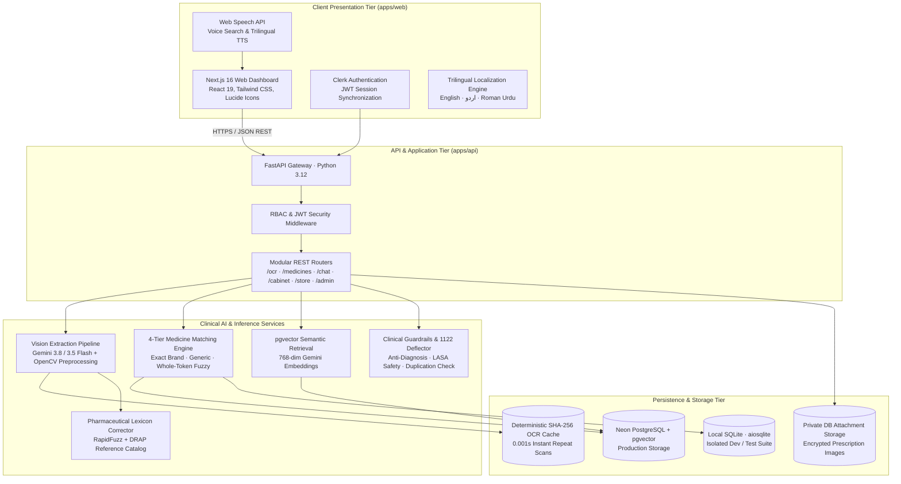

<div align="center">
  

  # Afiya AI (عافیہ اے آئی)

  **Enterprise-Grade Pharmaceutical Intelligence, Clinical Prescription Review & DRAP Price Transparency Platform**

  [](https://nextjs.org/)
  [](https://fastapi.tiangolo.com/)
  [](https://python.org/)
  [](https://www.typescriptlang.org/)
  [](https://neon.tech/)
  [](apps/api/tests)
  [](LICENSE)

  <p align="center">
    <a href="#executive-summary">Executive Summary</a> •
    <a href="#system-architecture">Architecture</a> •
    <a href="#core-capabilities">Core Capabilities</a> •
    <a href="#technology-stack">Tech Stack</a> •
    <a href="#local-development">Local Setup</a> •
    <a href="#testing--verification">Verification</a> •
    <a href="#deployment--operations">Deployment</a> •
    <a href="#medical-safety--compliance">Medical Safety</a> •
    <a href="#founding-team">Team</a>
  </p>
</div>

---

## Executive Summary

**Afiya AI** is a purpose-built pharmaceutical intelligence and digital health platform engineered specifically for Pakistan's retail pharmacy and primary care ecosystem. 

In Pakistan, patients and healthcare providers face severe systemic challenges:
- **1 in 4 medication dispensing errors** stem from messy cursive doctor handwriting and misunderstood Latin shorthand (*TDS, BD, ac, pc*).
- **Rampant retail pharmacy price inflation**, with consumers routinely overcharged **20% to 150%** above official Maximum Retail Prices (MRP) set by the Drug Regulatory Authority of Pakistan (DRAP).
- **Severe household financial distress** caused by originator brand monopolies, where families remain unaware of identical, bioequivalent local generic alternatives that cost **40% to 65% less**.
- **Dangerous polypharmacy and missed doses** among chronic disease patients (hypertension, diabetes) lacking structured adherence tools.

Afiya AI addresses these challenges through a unified, high-reliability architecture combining **multimodal vision OCR**, **DRAP statutory price auditing**, **bioequivalent generic matching**, **a regulated demonstration pharmacy marketplace with concierge pharmacist review**, **trilingual RAG clinical assistance**, and **a personal digital medicine cabinet with automated WhatsApp schedule sharing**.

---

## System Architecture



---

## Core Capabilities

### 1. Clinical Prescription Vision Review & Extraction
- **Multimodal Vision Engine:** Leverages Google Gemini multimodal vision models (`gemini-3.8-flash` primary with ordered fallback to `gemini-3.5-flash-lite` and `gemini-3.1-flash-lite`) paired with a bounded 35-second transport deadline.
- **Local Computer Vision Preprocessing:** Automatic orientation correction, shadow removal, and contrast enhancement (`image_preprocessor.py`) preserve faint pencil and ballpoint strokes.
- **Clinical Shorthand Decomposition:** Accurately extracts brand name, strength (`500mg`, `20mg`), dosage form (`Tablet`, `Injection`, `Capsule`, `Syrup`, `Inhaler`, `Cream`), frequency, and expands Pakistani shorthand (*"1+1"* $\rightarrow$ *"1 tablet twice daily after meals"*).
- **Form-Mismatch Guard:** Detects discrepancies between prescribed formulations and database records (e.g., flags an alert if an injection is prescribed but only capsules are stocked).
- **Deterministic SHA-256 Cache:** Scanned prescriptions are hashed and stored on disk; repeat scans return in **0.001s** with **0 API quota consumed**.
- **Concierge Pharmacist Handoff:** If handwriting is severely illegible or cloud providers timeout, requests transition seamlessly to a licensed pharmacist review queue.

### 2. Official DRAP MRP Compliance & Overcharge Auditor
- **Statutory Regulatory Baseline:** Grounded directly in official DRAP Statutory Regulatory Orders (S.R.O. gazettes) and Maximum Retail Price schedules.
- **Tri-State Audit Engine:** Evaluates retail pharmacy charges:
  - 🟢 **`OK_AT_MRP`:** Charged at or aligned with legal maximum retail prices.
  - 🔴 **`OVERCHARGED`:** Detects illegal price gouging, calculating the exact excess paid in PKR and percentage overcharged.
  - 🔵 **`BELOW_MRP`:** Identifies legitimate pharmacy promotional discounts.
- **Official Consumer Complaint Slip:** Generates exportable, printable dispute documents citing DRAP statutory provisions to present to pharmacy managers or provincial drug inspectors.

### 3. Bioequivalent Generic Substitution & Bachat Calculator
- **Bioequivalence Matching:** Instantly identifies all registered alternatives sharing the exact same active generic molecule, dosage strength, and formulation.
- **Differential Price Analysis:** Computes pack-level and unit-level price variance across brands, highlighting potential **40% to 65% monthly savings**.
- **Interactive Switcher:** Allows patients and pharmacists to compare manufacturer reputations and price differentials side-by-side.

### 4. Regulated Demonstration Pharmacy Marketplace & Smart Cart
- **Regulated Cart Workflow:** Connects reviewed prescriptions directly to a demonstration pharmacy ordering pipeline.
- **Prescription Attachment Gate:** Prevents checkout for prescription-only (Schedule G/Rx) medicines without an attached, validated prescription file.
- **Therapeutic Duplication Warnings:** Scans cart items in real time to prevent dangerous accidental double dosing of the same active generic molecule (e.g., taking Panadol and Paracetamol simultaneously).
- **Concierge Order Flow:** Allows patients to request manual pharmacist review and pack validation before order finalization.

### 5. Personal Digital Medicine Cabinet & Adherence Tracker
- **Persistent Cabinet Storage:** Tracks active medications, pack counts, and custom daily dosage directions.
- **Afiya Monthly Budget Estimator:** Aggregates total monthly household prescription expenditure based on DRAP benchmarks.
- **Daily Routine Reminders:** Interactive Morning (صبح), Afternoon (دوپہر), and Night (رات) reminder routines with browser push notification integration.
- **1-Click WhatsApp Family Share:** Encodes and formats complete daily medication schedules into an easy-to-read WhatsApp message for family members and caregivers.

### 6. Trilingual RAG Clinical Assistant & Multi-Layer Safety Engine
- **Trilingual Conversational AI:** Native interaction in English, Urdu script (اردو), and Roman Urdu (*"1 goli subah aur sham khane ke baad"*).
- **Vector-Grounded Retrieval:** PostgreSQL + pgvector (768-dimensional embeddings) grounds all responses in verified pharmaceutical data, preventing hallucinations.
- **Strict Anti-Diagnosis Guardrails:** Automatically refuses requests to diagnose illnesses or prescribe unverified treatments.
- **1122 Emergency Deflector:** Detects acute, life-threatening symptoms (cardiac arrest, stroke, poisoning, severe trauma) and immediately deflects users to **1122 Rescue Services**.

### 7. Enterprise Role-Based Admin Portal
- **Role-Based Access Control (RBAC):** Authenticates administrators via Clerk JWTs and strict allowlist verification (`ADMIN_EMAILS`).
- **Live Inventory & Price Overrides:** Manage active catalog medicines, update stock thresholds, and audit retail pricing.
- **Prescription Review Queue:** Dedicated interface for reviewing incoming prescription uploads, verifying extracted lines, and clearing concierge requests.
- **System Telemetry:** Real-time monitoring of database health, cache metrics, and API latency.

---

## Technology Stack

| Layer | Technologies | Description |
| :--- | :--- | :--- |
| **Frontend** | Next.js 16 (App Router), React 19, TypeScript | Server and client components utilizing Turbopack/Webpack |
| **Styling & UI** | Tailwind CSS, Lucide React, Framer Motion | Accessible, mobile-first responsive design |
| **Authentication** | Clerk Authentication (`@clerk/nextjs`) | Secure session handling, RBAC, and JWT authorization |
| **Voice Engine** | Web Speech API | Client-side speech-to-text search and trilingual synthesis |
| **Backend API** | Python 3.12, FastAPI 0.115, Pydantic v2 | High-throughput async REST API with schema validation |
| **ORM & Database** | SQLAlchemy 2.0 (Async), Alembic | Async migrations and data access |
| **Production DB** | Neon Serverless PostgreSQL + `pgvector` | Distributed SQL storage with 768-dim vector embeddings |
| **Local / Test DB** | SQLite (`aiosqlite`) | Zero-dependency isolated local execution and testing |
| **Vision & AI** | Google Gemini (`google-genai` SDK) | Multimodal Vision OCR, Gemini 3.5/3.8 Flash, text embeddings |
| **Image Processing** | Pillow (PIL), OpenCV / ImageOps | Contrast normalization, deskewing, ink sharpening |
| **String Matching** | RapidFuzz, Soundex | Phonetic and weighted Levenshtein matching against DRAP catalog |
| **Test Suite** | Pytest, AnyIO, AsyncIO | **386 automated backend tests** + frontend regression runners |

---

## Repository Layout

```text
AfiyaAI/
├── .env.example                               # Root environment configuration template
├── README.md                                  # Enterprise documentation (this file)
├── CODEX.md                                   # Comprehensive context guide for AI agents
├── MASTER_DOCUMENTATION.md                    # Deep architectural specification & audit trails
├── afiya_medicine_comparison_dataset_clean.json # Authoritative seed dataset (102 verified medicines)
│
├── apps/
│   ├── web/                                   # Next.js 16 Frontend Application
│   │   ├── src/app/                           # App Router pages (Dashboard, Admin, Privacy, Terms)
│   │   ├── src/components/                    # Component hierarchy:
│   │   │   ├── upload/                        # Prescription upload, review, and OCR result cards
│   │   │   ├── medicine/                      # Search, MRP checker, generic comparison, cabinet
│   │   │   ├── marketplace/                   # Regulated store, smart cart, concierge checkout
│   │   │   ├── chat/                          # Trilingual RAG chat interface & voice controllers
│   │   │   └── admin/                         # Admin analytics, review queue, inventory management
│   │   ├── src/lib/                           # Typed API client, i18n dictionaries, utility hooks
│   │   └── public/                            # Static assets, branding, and icons
│   │
│   └── api/                                   # FastAPI Backend Application
│       ├── app/
│       │   ├── db/                            # SQLAlchemy ORM models and database seeders
│       │   ├── models/                        # Pydantic v2 request/response schemas
│       │   ├── routers/                       # API route definitions (/ocr, /medicines, /chat, etc.)
│       │   ├── services/                      # Business logic, OCR cascade, matching, safety layer
│       │   ├── config.py                      # Application settings loaded via Pydantic BaseSettings
│       │   └── main.py                        # FastAPI lifespan application entrypoint
│       ├── alembic/                           # Versioned database migrations (up to head 0013)
│       ├── data/                              # Working dataset and .prescription_ocr_cache.json
│       └── tests/                             # 386 Automated pytest regression test cases
│
├── scripts/                                   # Release automation, verification & diagnosis scripts
├── specs/                                     # Formal system domain specifications (00 to 17)
└── docs/                                      # Deployment readiness, architectural decisions & QA
```

---

## Local Development

### Prerequisites
- **Python 3.12+**
- **Node.js 20.9+** & **npm 10+**
- **Git**

### 1. Backend Service Setup

Open a terminal at the repository root:

```powershell
# Navigate to backend directory
cd apps/api

# Create and activate Python virtual environment
python -m venv .venv
.\.venv\Scripts\Activate.ps1

# Install production and development dependencies
python -m pip install --upgrade pip
pip install -r requirements.txt
```

Create a local configuration file `apps/api/.env`:

```env
APP_ENV=development
DATABASE_URL=sqlite+aiosqlite:///./afiya.db
GEMINI_API_KEY=your_gemini_api_key_here
FRONTEND_URL=http://localhost:3000
JWT_SECRET=dev-insecure-secret-key-at-least-32-characters-long
ADMIN_EMAILS=admin@afiya.ai
```

Apply database migrations and start the development server:

```powershell
# Run Alembic migrations to create tables
python -m alembic upgrade head

# Start FastAPI server with live hot-reloading
python -m uvicorn app.main:app --reload --port 8000
```

- API Base URL: `http://localhost:8000`
- Interactive OpenAPI Docs: `http://localhost:8000/docs`
- Health Check: `http://localhost:8000/api/health`

### 2. Frontend Service Setup

Open a second terminal at the repository root:

```powershell
# Navigate to frontend directory
cd apps/web

# Install dependencies
npm ci
```

Create a local configuration file `apps/web/.env.local`:

```env
NEXT_PUBLIC_API_URL=http://localhost:8000
NEXT_PUBLIC_CLERK_PUBLISHABLE_KEY=your_clerk_publishable_key
CLERK_SECRET_KEY=your_clerk_secret_key
```

Start the Next.js development server:

```powershell
# Default Turbopack dev server
npm run dev

# Alternative Webpack dev server (recommended if Turbopack encounters platform locks)
npm run dev -- --webpack
```

Access the web dashboard at `http://localhost:3000`.

---

## Testing & Verification

Afiya AI enforces continuous quality assurance through comprehensive unit, integration, and end-to-end regression test suites.

```powershell
# Run the complete backend automated test suite (386 tests)
cd apps/api
pytest tests

# Or run isolated verification from root (covers backend, catalog, and marketplace)
python scripts/run_backend_tests_isolated.py
node scripts/test-catalog.cjs
node scripts/test-ocr-concierge.cjs
node scripts/test-marketplace-prescriptions.cjs
node scripts/test-marketplace-web.cjs

# Verify frontend production build compiles cleanly without TypeScript errors
npm --prefix apps/web run build
```

---

## Deployment & Operations

### Production Topography
- **Frontend Hosting:** Vercel (Production branch `main`, Root `apps/web`, Output Next.js SSR)
- **Backend API Hosting:** Render or Railway (Python 3.12 runtime, Root `apps/api`, Start `python -m uvicorn app.main:app --host 0.0.0.0 --port $PORT`)
- **Managed Database:** Neon Serverless PostgreSQL with `pgvector` extension

### Production Database Migration Sequence
To safely promote schema migrations without downtime:

```powershell
# 1. Preview pending migrations against target database
python scripts/prepare_database_release.py --database-env-file apps/api/.env

# 2. Execute migrations with automatic rollback snapshot
python scripts/prepare_database_release.py --database-env-file apps/api/.env --apply-migrations --snapshot-before-migrate
```

*The current migration head is `0013` (private database-backed prescription attachments).*

---

## Medical Safety & Compliance

> [!CAUTION]
> **STATUTORY MEDICAL DISCLAIMER**
> 
> Afiya AI is an **educational and informational decision-support prototype**. It is **NOT** a medical diagnostic device, licensed physician, or prescribing clinician.
> 
> 1. **NO DIAGNOSIS OR PRESCRIBING:** The platform strictly prohibits diagnostic recommendations. Users presenting symptoms are explicitly instructed to consult a licensed medical practitioner.
> 2. **EMERGENCY DEFLECTION:** Users exhibiting critical red-flag symptoms (cardiac distress, stroke, poisoning, severe respiratory distress) are immediately redirected to **1122 Emergency Services**.
> 3. **INDEPENDENT VERIFICATION:** Prescription OCR output represents optical machine recognition and may misinterpret handwriting. Patients must confirm all extracted medication names, dosages, and administration frequencies with a qualified pharmacist or doctor before taking any medicine.
> 4. **BIOEQUIVALENCE NOTICE:** Matching identical generic molecules, strengths, and dosage forms represents a comparative pharmaceutical indicator; it does not substitute for clinical bioequivalence determination by a physician.

---

## Founding Team

Afiya AI was conceptualized, architected, and engineered by:

| Contributor | Role & Core Responsibilities |
| :--- | :--- |
| **Muhammad Taha Khan** | **Team Lead & Project Visionary**<br>Product strategy, DRAP regulatory framework research, stakeholder coordination, and presentation pitch lead. |
| **Muhammad Mubashir Khalid** | **Lead Full-Stack Developer & Software Architect**<br>End-to-end software architecture, Next.js 16 UI implementation, FastAPI backend services, Gemini Vision OCR integration, PostgreSQL + pgvector RAG pipeline, and 386-test automated verification suite. |
| **Muhammad Sultan Abbasi** | **Research & Quality Assurance**<br>Official DRAP pricing dataset curation, pharmaceutical catalog verification, and clinical edge-case quality assurance testing. |

---

<div align="center">
  <sub>Developed with pride for Pakistan's healthcare ecosystem. © Afiya AI Team. Licensed under the MIT License.</sub>
</div>
