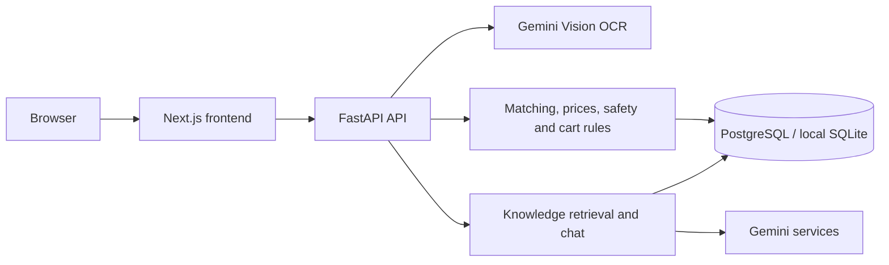

<div align="center">


# Afiya AI

Medicine information, prescription review, and price transparency for Pakistan.

**Hackathon MVP · Next.js + FastAPI · PostgreSQL / SQLite**

[Features](#features) · [Local setup](#local-setup) · [Verification](#verification) · [Deployment](#deployment) · [Limitations](#limitations-and-medical-safety)
</div>

Afiya AI helps users read prescription images, review extracted medicine names, find supported medicines in a curated catalog, and compare stored price references. English, Urdu, and Roman Urdu interfaces make the information more accessible. A demonstration pharmacy marketplace connects reviewed items to a smart cart and a pharmacist review workflow.

This is an educational hackathon prototype. It does not diagnose, prescribe, recommend treatment, or establish that two products are clinically interchangeable. Users must confirm OCR readings and consult a qualified doctor or pharmacist about medication decisions.

## Features

| Area | Implemented functionality |
| --- | --- |
| Prescription review | Gemini Vision extraction, image preprocessing, bounded model fallback, uncertainty indicators, manual confirmation, and scan progress |
| Medicine catalog | Search, category filters, pagination, stored source references, and supported medicine details |
| Price transparency | Stored pharmacy prices, pack-aware comparisons, MRP reference checks, and same-generic/strength/form comparison candidates |
| Safety checks | Rule-based therapeutic duplication warnings, reference batch alerts, and prescription gates in the demonstration cart |
| Personal cabinet | Saved medicines, quantity/pack selection, budget estimates, and reminder preferences |
| Multilingual assistance | English, Urdu, and Roman Urdu chat with retrieval and safety checks; voice input where supported |
| Marketplace demo | Smart cart, switch suggestions, prescription review queue, concierge requests, and buyer order history |
| Admin portal | Analytics, order review, inventory guards, catalog sync, seller status management, and registered users |
| Transparency | Privacy and terms pages, contextual disclosures, source labels, explicit demo labeling, and custom 404 page |

### Dataset and provenance

The bundled medicine dataset contains **102 records**. Catalog inclusion alone does not prove current DRAP registration, source verification, availability, or clinical equivalence. Price values are stored reference snapshots; this application does not guarantee live pharmacy pricing.

The root dataset, `afiya_medicine_comparison_dataset_clean.json`, is used by the current medicine and MRP seeders. Preserve its path when building the monorepo. Sources and verification status should be reviewed before relying on any record.

### Demonstration marketplace

Synthetic pharmacy names, license identifiers, stock quantities, and historical orders are retained for presentations and labeled as demonstrations. They do not represent completed patient sales or verified pharmacy partners.

The admin dashboard defaults to demo metrics and provides a switch to non-demo activity. Both views summarize order records; neither proves that payment was collected. Payment processing, delivery integration, and real professional license verification are outside the current implementation.

## Architecture



OCR output is a reading to review, not verified medicine data. Matching and price calculations use stored records. PostgreSQL supports pgvector retrieval when embeddings are populated; local SQLite uses a different retrieval path. Generated explanations and summaries can still be incorrect.

| Layer | Stack |
| --- | --- |
| Web | Next.js 16, React 19, TypeScript, Tailwind CSS, Lucide, Framer Motion |
| API | Python, FastAPI, Pydantic, SQLAlchemy async |
| Persistence | Neon PostgreSQL, pgvector, Alembic; SQLite for local development/tests |
| AI | Google Gemini; OCR uses the `google-genai` SDK |
| Authentication | Clerk integration and signed bearer tokens, admin authorization |
| Verification | Pytest and frontend regression scripts, production Next.js build |
| Hosting | Vercel frontend, Render backend, Neon database |

## Repository layout

```text
apps/api/
  app/db/              Models and controlled seeders
  app/routers/         API endpoints
  app/services/        OCR, retrieval, matching, safety and marketplace logic
  app/models/          Core API schemas
  alembic/versions/    Versioned schema migrations
  tests/               Backend unit and integration tests
apps/web/
  src/app/             Main, admin, privacy, terms and server routes
  src/components/      Buyer, admin and shared UI
  src/lib/             Typed API client and UI utilities
  public/              Branding and static assets
scripts/               Isolated checks and development utilities
specs/                 Product and implementation specifications
docs/                  Architecture, local fixes and QA notes
afiya_medicine_comparison_dataset_clean.json
```

## Local setup

Use **Python 3.12** and **Node.js 20.9 or newer**. Commands below assume PowerShell and start from the repository root. Keep credentials in local configuration or hosting dashboards; never commit real environment files.

### Backend

```powershell
cd apps/api
python -m venv .venv
.\.venv\Scripts\Activate.ps1
python -m pip install -r requirements.txt
```

Configure local settings privately before starting. Important backend settings:

| Setting | Purpose |
| --- | --- |
| `DATABASE_URL` | Async SQLAlchemy connection URL; use a separate local database for development |
| `GEMINI_API_KEY` | Provider credentials for OCR/chat/embeddings |
| `FRONTEND_URL` | Allowed frontend origin, such as `http://localhost:3000` |
| `JWT_SECRET` | Signing secret; production requires a non-default value of at least 32 characters |
| `APP_ENV` | `development` locally; `production` on the hosted API |
| `ADMIN_EMAILS` | Explicit comma-separated admin allowlist |
| `CLERK_JWKS_URL`, `CLERK_ISSUER`, `CLERK_AUDIENCE` | Configure to match the intended Clerk instance and token validation |

For SQLite development, an example connection value is `sqlite+aiosqlite:///./afiya.db`. Do not point development commands at the production database accidentally.

```powershell
python -m alembic upgrade head
python -m uvicorn app.main:app --reload --port 8000
```

The API is at `http://localhost:8000`; docs are at `/docs` and the health endpoint is `/api/health`.

SQLite startup creates missing tables and runs local seeders. Existing databases still need migrations for new columns. PostgreSQL startup validates the schema and **does not seed or migrate it automatically**.

### Frontend

Open a second terminal from the repository root:

```powershell
cd apps/web
npm ci
```

Configure `NEXT_PUBLIC_API_URL=http://localhost:8000` privately, along with the Clerk publishable key and server credentials required by your authentication setup. Public variables are visible to the browser; never put private API keys in `NEXT_PUBLIC_*` variables.

```powershell
npm run dev
```

Open `http://localhost:3000`. If the local Turbopack compiler stalls on your machine, use the tested Webpack alternative:

```powershell
npm run dev -- --webpack
```

On another device, `localhost` refers to that device. Mobile testing requires a reachable backend address and an allowed frontend origin; forwarding the frontend alone is insufficient.

### OCR configuration

The current source-defined model order in `apps/api/app/services/ocr_models.py` is:

1. `gemini-3.8-flash`
2. `gemini-3.5-flash-lite`
3. `gemini-3.1-flash-lite`

The per-request transport timeout is 35 seconds. These are the identifiers configured in this repository, not a guarantee of current provider availability or account access. Verify model support and quota for your project before a demonstration. Total scan duration can exceed one request because extraction may involve fallback and review.

If cloud extraction fails, the API returns an `OCR_SERVICE_BUSY` response and the UI offers the concierge workflow. The concierge flow also requires working authentication and prescription attachment storage.

## Verification

Run from the repository root:

```powershell
python scripts/run_backend_tests_isolated.py
node scripts/test-catalog.cjs
node scripts/test-ocr-concierge.cjs
node scripts/test-marketplace-prescriptions.cjs
node scripts/test-marketplace-web.cjs
node scripts/build-web-isolated.cjs
```

The isolated runners use test configuration rather than real environment files or production services. Activate the backend virtual environment before running the Python command.

The latest recorded local verification was **386 backend tests passed**, **15 frontend regression tests passed**, and a successful production Webpack build. These are recorded results, not a live CI badge; rerun them for the release commit. They do not establish handwriting accuracy, live model availability, or production database compatibility.

## Deployment

### What updates automatically?

| Service | Effect of pushing to the configured production branch |
| --- | --- |
| Vercel | Builds/deploys the frontend when the Git integration and deployment settings permit it |
| Render | Builds/deploys the API when automatic deployment is enabled for that branch |
| Neon | Continues hosting PostgreSQL; a code push alone does not apply Alembic migrations or seed data |

The same local folder does not determine deployment. The linked repository, branch, project root, build configuration, and environment variables do.

### Production configuration

| Service | Required configuration |
| --- | --- |
| Vercel | Production branch `main`; root `apps/web`; install `npm ci`; build `npm run build` (selects the verified Webpack path); production `NEXT_PUBLIC_API_URL` points to Render |
| Render | Branch `main`; root `apps/api`; build `pip install -r requirements.txt`; start `python -m uvicorn app.main:app --host 0.0.0.0 --port $PORT` |
| Render environment | Production `DATABASE_URL`, `APP_ENV=production`, secure `JWT_SECRET`, Gemini credentials, correct `FRONTEND_URL`, admin allowlist, and Clerk token configuration |
| Neon | Correct target branch/database, migrations applied, and deliberately imported reference/demo data as required |

Do not use `--reload` in production. Configure Clerk's production domains and keys for the deployed frontend. Changing a browser-exposed environment value requires rebuilding the frontend.

### Database release procedure

1. Create a database backup or isolated Neon branch before changing the production schema.
2. Test the release migrations against that branch using the same connection configuration as deployment.
3. From `apps/api`, with the **intended database connection configured**, run:

   ```text
   python -m alembic current
   python -m alembic upgrade head
   python -m alembic current
   ```

4. The current migration head is `0013` (private prescription attachments). Do not manually stamp a database to skip unapplied schema changes.
5. Apply migrations before the new API serves traffic. A Render pre-deploy command can run `python -m alembic upgrade head` on plans that support it. Otherwise arrange a controlled migration task; do not assume startup performs it.
6. Review reference-data changes separately. Explicit entry points include `python -m app.db.seed_data`, `python -m app.db.seed_mrp`, and `python -m app.db.seed_knowledge`. The catalog seeder can update existing data; inspect its changes before using it on production.
7. Demo alerts and marketplace inventory/history are separate, opt-in imports on PostgreSQL. `seed_marketplace(db)` is an async seeding function, not a standalone executable module. Run it only through a reviewed task against the intended demo database. Do not import synthetic sales into real business reporting.

Local SQLite databases, users, prescriptions, caches, inventory, and orders are not transferred by Git. Generating PostgreSQL embeddings is also a separate operation, not part of a normal code deployment.

### Private prescription storage

Prescription attachments are stored in the API database with owner/admin access checks. Browser uploads go directly to FastAPI, avoiding frontend function upload limits. Existing `/uploads/{uuid}` references resolve through authenticated API reads; the web read proxy remains for compatibility. Both browser uploads and admin previews bypass frontend function body limits. Apply migration `0013` before deploying this version. Old local-disk attachments are not automatically transferred.

Database-backed image storage is a bounded MVP solution (10 MiB per image), not a complete patient-document platform. Retention, deletion, capacity planning and a future private object-storage migration require operational work.

### Controlled release command

From the repository root, `scripts/prepare_database_release.py` previews the configured database without changing it. By default it only uses `AFIYA_ALEMBIC_DATABASE_URL` or `DATABASE_URL` from the process environment; it disables application dotenv loading. An explicit `--database-env-file apps/api/.env` flag permits reading that file's connection value without printing credentials.

```powershell
python scripts/prepare_database_release.py --database-env-file apps/api/.env
python scripts/prepare_database_release.py --database-env-file apps/api/.env --apply-migrations --snapshot-before-migrate
```

Run the second command only after reviewing the target and securing a database backup/test branch. The snapshot flag additionally copies affected table rows to a private schema in the same PostgreSQL database; this is a migration recovery reference, not an independent backup. Optional `--sync-reference-data` updates stored reference records; `--seed-demo` inserts labeled synthetic marketplace/alert data. These data flags require `--apply-migrations` and are never enabled implicitly. The tool checks the final migration head and model columns before running seeders. It never commits, pushes, merges, or deploys.

### Git release sequence

Work is currently developed on `feature/smart-marketplace`. Review and commit only release files; exclude environment files, local OCR caches, patient images, scratch harnesses, and generated artifacts.

```powershell
git switch feature/smart-marketplace
git status --short
git add -u -- . ':!apps/api/data/.prescription_ocr_cache*'
```

Add required new application files, assets, tests, specs, and scripts by their explicit paths. The command above stages tracked changes only; new files still need deliberate staging. Inspect the result before committing:

```powershell
git diff --cached --stat
git diff --cached --name-only
git diff --cached --check
git commit -m "feat: prepare Afiya AI marketplace and interface release"
git push -u origin feature/smart-marketplace
```

Open a pull request from `feature/smart-marketplace` into `main`, review the diff and checks, then merge when hosting settings, migrations, and deployed attachment checks are ready. A merge to the connected production branch can immediately trigger deployments. Do not force-push to resolve branch differences.

After deployment, confirm both services are running the intended commit. Check API health, sign-in, medicine search, catalog, cart gates, admin authorization, privacy/terms routes, and the full prescription upload-to-review flow on the deployed site.

Deployment references: [Vercel Git integration](https://vercel.com/docs/git), [Render deployment lifecycle](https://render.com/docs/deploys), and [Neon database branching](https://neon.com/docs/introduction/branching).

## Limitations and medical safety

- Handwritten OCR can miss, duplicate, or misread products, forms, and strengths. A representative pharmacist-reviewed accuracy benchmark is still needed.
- AI-generated summaries and explanations require independent verification. No zero-hallucination or diagnostic accuracy claim is made.
- Same generic, strength, or dosage form is a comparison rule, not proof of bioequivalence or permission to switch treatment.
- Prices, alerts, and source verification reflect stored records and their coverage; always check the current source and pharmacy.
- Quota, timeouts, and model availability affect cloud features. Passing mocked provider tests does not verify live service access.
- The prototype has no payment gateway, delivery service, or automatic legal/license verification. Order status is not payment confirmation or proof of professional review.
- Retention, deletion, durable storage, production monitoring, and operational controls need further work before handling real patient data at scale.
- Use fictional or fully deidentified prescriptions for demonstrations and follow the configured provider's data terms. Read [Google's Gemini API terms](https://ai.google.dev/gemini-api/terms) before submitting sensitive information.

The application includes `/privacy` and `/terms`. Until the team publishes an official support address, the existing feedback form is the temporary contact route. These prototype pages require appropriate review before a public medical service launch.

## Team

| Contributor | Role |
| --- | --- |
| Muhammad Taha Khan | Team lead, product vision, planning, and presentation |
| Muhammad Mubashir Khalid | Full-stack engineering, architecture, integrations, and implementation |
| Muhammad Sultan Abbasi | Research, data review, and quality assurance |

For implementation details, see [specs](specs/), [local fixes](docs/LOCAL_FIXES.md), [OCR notes](docs/OCR_LOCAL_FIXES.md), [feature QA](docs/FEATURE_QA.md), and [transparency and demo mode](specs/16-transparency-and-demo-mode.md).

Latest release preparation and production database verification: [deployment readiness](docs/DEPLOYMENT_READINESS.md).
