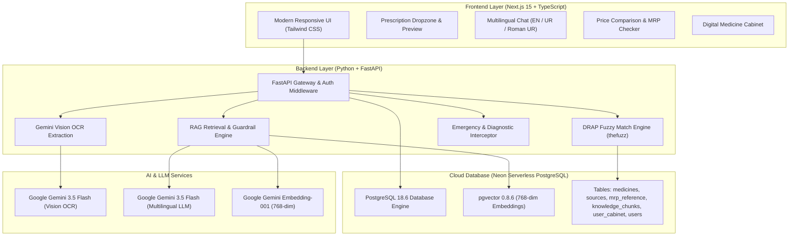

<div align="center">


# Afiya AI (عافیہ)
### *Your Intelligent Medicine Assistant for Pakistan*

[](https://nextjs.org/)
[](https://www.typescriptlang.org/)
[](https://fastapi.tiangolo.com/)
[](https://www.postgresql.org/)
[](https://github.com/pgvector/pgvector)
[](https://ai.google.dev/)
[](https://docs.pytest.org/)

**Afiya AI is an AI-powered medicine assistant designed for Pakistan.** It extracts medicine names from doctor prescription images via multimodal vision, verifies them against authoritative Drug Regulatory Authority of Pakistan (DRAP) records across **100+ medicines in 36 comparison groups**, discovers verified same-generic alternative brands to unlock massive healthcare savings, checks government-notified Maximum Retail Prices (MRP), compares retail pharmacy prices, and delivers multilingual medical explanations in **English, Urdu (اردو), and Roman Urdu** using vector RAG.

[Live Demo](#-deployment--live-links) • [Features](#-key-features) • [Architecture](#-system-architecture) • [Tech Stack](#-technology-stack) • [Setup Guide](#-local-development-setup) • [Team](#-team--project-credits)

</div>

---

## 📌 Problem Statement & Solution

In Pakistan and developing healthcare systems:

1. **Handwritten Prescriptions**: Doctor handwriting is notoriously difficult for patients to decipher.
2. **Price Gouging & Overcharging**: Patients often pay inflated prices above government-regulated MRP ceilings due to a lack of price transparency.
3. **Expensive Brand Monopolies**: Patients are often prescribed expensive originator brands unaware that identical, bioequivalent generic alternatives exist at up to 60% lower costs.
4. **Language Barrier**: Most pharmaceutical documentation and inserts are strictly in English, creating a disconnect for Urdu and Roman Urdu speakers.
5. **Safety & AI Hallucinations**: Generic AI chatbots frequently invent medical advice or dosages, posing real health risks.

### 💡 The Afiya AI Solution:

- **Vision OCR Extraction**: Uses Google Gemini Multimodal Vision to accurately extract drug names, strengths, and forms from prescription photos.
- **Authoritative Matching**: Fuzzy-matches extracted candidates against 100+ curated, DRAP-registered medicines across 36 therapeutic comparison groups.
- **Bioequivalent Alternatives & Savings Engine**: Instantly discovers cheaper alternative brands with the exact same active pharmaceutical generic ingredient, strength, and dosage form, calculating per-unit savings and percent discounts.
- **Price Transparency & MRP Watchdog**: Compares real-time prices across leading Pakistani retail pharmacies (Dvago, Sehat, Dawaai) and checks compliance against DRAP-aligned Maximum Retail Price reference baselines.
- **Symptom & Condition Advisory**: Intelligently identifies common symptoms (headache, fever, body aches, acidity, allergies) and suggests generally used medicines from the database with strict non-guarantee advisories and doctor confirmation directives.
- **Grounded Vector RAG (pgvector)**: Queries 768-dimensional dense vector embeddings stored in PostgreSQL to provide strict, zero-hallucination medical explanations.
- **Multilingual Support**: Fully localized in **English**, authentic **Nastaliq Urdu (اردو)**, and **Roman Urdu**.
- **Mandatory Auth Protection**: Protects search, category browsing, prescription uploading, and clinical views with secure Clerk/JWT authentication while keeping the AI chatbot open for guest visitors.
- **Digital Medicine Cabinet**: Allows logged-in users to save medications and receive automatic safety alerts if any batch is recalled by DRAP.

---

## ✨ Key Features

```
├── 📷 Multimodal Prescription OCR       ── Instant drug extraction from handwritten/printed prescriptions
├── 💡 Bioequivalent Brand Alternatives   ── Cheaper same-generic alternatives with unit prices & % savings
├── ⚖️ Multi-Pharmacy Price Comparison   ── Real-time price tracking across top Pakistani pharmacies
├── 🛡️ DRAP MRP Overcharge Checker       ── Compares pharmacy prices against DRAP baseline price references
├── 🩺 Symptom & Condition Advisory      ── Guardrailed medicine advice for symptoms with doctor confirmation
├── 🧠 Multilingual Chat RAG (pgvector)  ── Grounded AI responses in English, Urdu (اردو), and Roman Urdu
├── 🔒 Mandatory Authentication Gates    ── Protected search, categories, upload & info with guest chat access
├── 🗄️ Digital Medicine Cabinet          ── Personal prescription manager with DRAP recall watchdog alerts
├── 🔐 Role-Based Access Control (RBAC)   ── Secure JWT authentication with dedicated Admin & Auditor portal
├── 💬 Community Feedback System         ── In-app user rating and feedback collection
└── 🏥 Strict Medical Safety Guardrails  ── Zero diagnosis/prescribing, instant emergency keyword interception
```

---

## 🏗️ System Architecture



---

## 🛠️ Technology Stack

| Layer                         | Technologies                                                                                                                                                                                                        |
| :---------------------------- | :------------------------------------------------------------------------------------------------------------------------------------------------------------------------------------------------------------------ |
| **Frontend**                  | [Next.js 16](https://nextjs.org/) (App Router), [React 19](https://react.dev/), [TypeScript](https://www.typescriptlang.org/), [Tailwind CSS](https://tailwindcss.com/), Lucide Icons                               |
| **Backend**                   | [FastAPI](https://fastapi.tiangolo.com/), [Uvicorn](https://www.uvicorn.org/), [Pydantic v2](https://docs.pydantic.dev/), [Python 3.12](https://www.python.org/)                                                    |
| **Database & Vector Search**  | [Neon Serverless PostgreSQL](https://neon.tech/) (v18.6), [pgvector](https://github.com/pgvector/pgvector) (0.8.6), [SQLAlchemy 2.0 Async](https://www.sqlalchemy.org/), [Alembic](https://alembic.sqlalchemy.org/) |
| **AI / OCR / Embeddings**     | [Google Gemini 3.5 Flash](https://ai.google.dev/) (Multimodal OCR & Multilingual Chat), [Gemini Embedding-001](https://ai.google.dev/) (768-dim Vector Embeddings)                                                  |
| **Authentication & Security** | [Clerk](https://clerk.com/) & PyJWT (Signed Bearer Tokens), Passlib (Bcrypt Hashing), Role-Based Access Control (RBAC)                                                                                              |
| **Testing**                   | [Pytest](https://pytest.org/), [Pytest-Asyncio](https://pytest-asyncio.readthedocs.io/) (131 Automated Unit & Integration Tests)                                                                                    |
| **Deployment**                | [Vercel](https://vercel.com/) (Frontend), [Railway](https://railway.app/) / [Render](https://render.com/) (Backend), [Neon](https://neon.tech/) (Database)                                                          |

---

## 📂 Repository Structure

```
AfiyaAI/
├── apps/
│   ├── api/                          # FastAPI Python Backend
│   │   ├── alembic/                  # Database migration versions (0001 - 0009)
│   │   ├── app/
│   │   │   ├── db/                   # Database engine, ORM models, seeders & pgvector scripts
│   │   │   │   ├── database.py       # SQLAlchemy Base & declarative models
│   │   │   │   ├── seed_data.py      # 100+ DRAP-registered medicines & market prices
│   │   │   │   ├── seed_mrp.py       # DRAP-aligned MRP price baseline reference
│   │   │   │   ├── seed_knowledge.py # Grounded knowledge chunk generation
│   │   │   │   └── seed_embeddings.py# 768-dim Gemini vector embeddings generator
│   │   │   ├── models/               # Pydantic request/response schemas
│   │   │   ├── routers/              # API endpoints (auth, ocr, medicines, chat, price_check, cabinet, feedback, admin)
│   │   │   ├── services/             # Core business logic (OCR, matching, RAG, safety, alternatives)
│   │   │   ├── config.py             # App environment configuration
│   │   │   └── main.py               # FastAPI entrypoint, lifespan & CORS
│   │   ├── tests/                    # 131 unit and integration test suite
│   │   ├── requirements.txt          # Python dependencies
│   │   └── alembic.ini               # Alembic database configuration
│   │
│   └── web/                          # Next.js 16 TypeScript Frontend
│       ├── public/                   # Static assets, branding, and icons
│       ├── src/
│       │   ├── app/                  # Next.js App Router (layout, page, admin)
│       │   ├── components/           # Reusable UI component modules
│       │   │   ├── auth/             # Login / Register & Clerk auth sync
│       │   │   ├── chat/             # AI RAG Chat interface
│       │   │   ├── feedback/         # Community rating & feedback modal
│       │   │   ├── guide/            # Interactive onboarding tour
│       │   │   ├── layout/           # Header, Footer, Navigation
│       │   │   ├── medicine/         # MedicineCard, PriceTable, MrpChecker, CabinetModal
│       │   │   ├── shared/           # CustomCursor, ThemeToggle, Toast, Disclaimer
│       │   │   └── upload/           # Prescription ImageUploader & OCRResults
│       │   └── lib/                  # API client, auth helpers, types, i18n localization
│       ├── package.json              # Node.js dependencies
│       ├── tailwind.config.ts        # Tailwind styling & dark mode setup
│       └── tsconfig.json             # TypeScript compiler settings
│
├── data/                             # Curated DRAP reference datasets (102 medicines, 36 comparison groups)
├── docs/                             # Architecture Decision Records (ADRs) & Specs
├── AGENTS.md                         # Project development rules & guidelines
└── README.md                         # Master documentation (this file)
```

---

## ⚡ Local Development Setup

### 1. Prerequisites

- **Node.js**: v18+ or v20+
- **Python**: v3.11+ or v3.12+
- **Google Gemini API Key**: Obtainable from [Google AI Studio](https://aistudio.google.com/)

---

### 2. Backend Setup (FastAPI)

```powershell
# Navigate to api directory
cd apps/api

# Create & activate Python virtual environment
python -m venv venv
.\venv\Scripts\activate      # Windows (PowerShell)
# source venv/bin/activate   # macOS / Linux

# Install dependencies
pip install -r requirements.txt

# Create .env configuration
cp .env.example .env
```

Configure your `apps/api/.env`:

```env
DATABASE_URL=postgresql+asyncpg://neondb_owner:<password>@<neon-host>/neondb?ssl=require
GEMINI_API_KEY=your_gemini_api_key_here
JWT_SECRET=your_super_secret_jwt_key_here
FRONTEND_URL=http://localhost:3000
ADMIN_EMAILS=admin@afiya.ai
```

Run database migrations & start the backend:

```powershell
# Apply all 8 database migrations
alembic upgrade head

# Start FastAPI server
uvicorn app.main:app --reload --host 0.0.0.0 --port 8000
```

- **Backend API**: `http://localhost:8000`
- **Interactive Swagger Docs**: `http://localhost:8000/docs`

---

### 3. Frontend Setup (Next.js)

```powershell
# Navigate to web directory
cd apps/web

# Install dependencies
npm install

# Create .env.local configuration
cp .env.example .env.local
```

Configure your `apps/web/.env.local`:

```env
NEXT_PUBLIC_API_URL=http://localhost:8000
```

Start the Next.js development server:

```powershell
npm run dev
```

- **Web Application**: `http://localhost:3000`

---

## 🚀 Deployment & Live Links

| Component | Platform | Configuration / Build Command | Live URL |
| :--- | :--- | :--- | :--- |
| **Frontend Web App** | [Vercel](https://vercel.com/) | Next.js 15 App (`apps/web`) | [**`https://afiya-ai.vercel.app`**](https://afiya-ai.vercel.app) |
| **Backend REST API** | [Railway](https://railway.app/) | FastAPI Python 3.12 (`apps/api`) | [**`https://afiyaai-production.up.railway.app`**](https://afiyaai-production.up.railway.app) |
| **Interactive API Docs** | [Swagger UI](https://swagger.io/) | Auto-generated OpenAPI 3.1 | [**`https://afiyaai-production.up.railway.app/docs`**](https://afiyaai-production.up.railway.app/docs) |
| **Vector Database** | [Neon](https://neon.tech/) | PostgreSQL 18.6 + `pgvector` 0.8.6 (768-dim) | *Managed Cloud (Live)* |

---

## 🧪 Testing & Quality Assurance

Afiya AI includes a comprehensive automated test suite with **131 unit and integration tests** covering:

- Prescription OCR candidate extraction and parsing
- Fuzzy medicine name matching and DRAP registration verification
- Bioequivalent alternative brands grouping, price comparisons, and % savings calculations
- Vector similarity search and pgvector RAG context retrieval
- Symptom and common condition medicine advisory with mandatory non-guarantee and doctor confirmation directives
- Emergency keyword detection and diagnostic refusal safety guardrails
- Price gouging detection and DRAP MRP baseline validations
- Mandatory authentication gating across search, categories, upload, and clinical views
- JWT authentication, password hashing, Clerk RS256 issuer/audience verification, and Admin RBAC gating
- Community feedback submission, validation, and analytics retrieval
- Migration reversibility (0001 - 0009) and database schema integrity

```powershell
cd apps/api
pytest -q
```

```
========================= 131 passed in 103.81s =========================
```

---

## 🔒 Medical Ethics & Safety Guardrails

> [!IMPORTANT]
> **Afiya AI is strictly an educational information assistant and NOT a medical practitioner.**
>
> - **Zero Prescriptions / Disease Diagnosis**: The system is programmatically barred from providing clinical diagnoses or prescribing treatments.
> - **Symptom & Condition Advisory**: When users ask what medicine to take for common symptoms (e.g., headache, fever, pain, acidity), the assistant suggests commonly used medicines from the database as informational advice, explicitly disclaims any 100% guarantee, and instructs the user to consult a doctor or pharmacist for confirmation before taking any medication.
> - **Grounded Fact Retrieval**: Structured medicine facts (ingredients, manufacturer, MRP, prices, alternative brands) originate strictly from authoritative DRAP records, never from generative hallucination.
> - **DRAP Reference Grounding**: Price comparisons are presented as DRAP-aligned baseline references, noting that statutory enforcement requires official published Gazette SRO citations.
> - **Emergency Interception**: Any critical medical query (e.g., chest pain, overdose, difficulty breathing, poisoning) immediately triggers an urgent emergency deflection advising the user to call 1122 or visit the nearest hospital.

---

## 👥 Team & Project Credits

<div align="center">

| Name                         | Role                                              | Responsibilities & Contributions                                                                                                                                                                                                                                                                                                                                                                                    |
| :--------------------------- | :------------------------------------------------ | :------------------------------------------------------------------------------------------------------------------------------------------------------------------------------------------------------------------------------------------------------------------------------------------------------------------------------------------------------------------------------------------------------------------ |
| **Muhammad Taha Khan**       | **Team Lead & Project Visionary**                 | • Conceptualized the original project idea<br>• Project planning, strategic direction & team management<br>• Pitch deck preparation & presentation delivery                                                                                                                                                                                                                                                         |
| **Muhammad Mubashir Khalid** | **Sole Full-Stack Developer & Software Engineer** | • **Engineered the complete technical codebase end-to-end**<br>• Designed & implemented the Next.js 16 UI and interactive components<br>• Built the Python FastAPI backend, REST endpoints & middleware<br>• Architected the PostgreSQL + pgvector (768-dim) RAG pipeline<br>• Integrated Gemini Multimodal Vision OCR with fallback cascades<br>• Authored all 9 Alembic database migrations & 131 automated tests |
| **Muhammad Sultan Abbasi**   | **Research & Quality Assurance**                  | • DRAP official medicine pricing & registration dataset research<br>• User acceptance testing & edge-case scenario validation<br>• Pharmaceutical data verification & documentation review                                                                                                                                                                                                                          |

</div>

---

<div align="center">

**Built with ❤️ for Pakistan's Digital Healthcare Future.**

</div>
